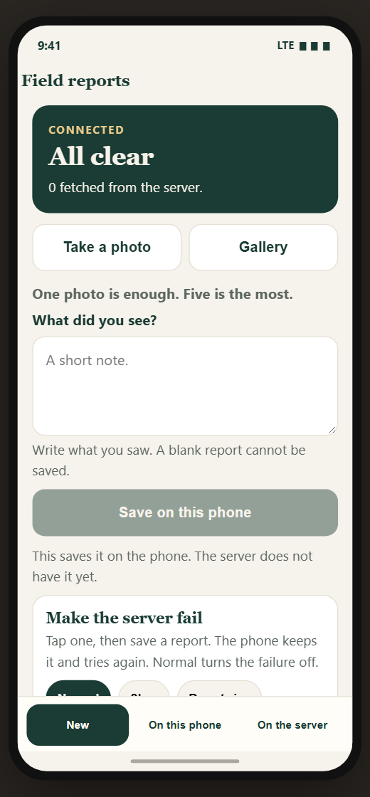
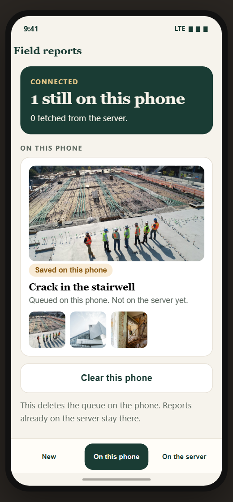
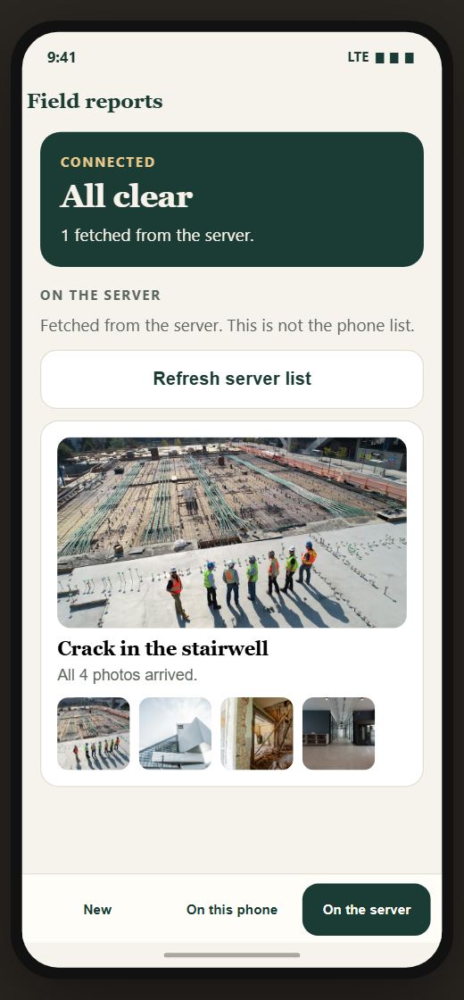

## Field Reports

One inspector, one phone, and a bad connection. The report is a short note and 1 to 5 photos. The network is often 2G and it dies in the middle of a send. The report still has to reach the server, exactly once.

Saving a report on the phone and having it on the server are two different facts. The screen never treats them as the same thing.

There is no login. The brief asked for none. The person using it is the inspector standing on site.

## Screens

The app starts empty. The photos in the second and third pictures are only there to show the layout. They are not shipped inside the app.

**New.** Camera, gallery, and save are on the first screen.



**On this phone.** A saved report lives here. The server does not have it yet.



**On the server.** This list is fetched after the server accepts the photos.



## Run it

You need Node 22+, JDK 17, and the Android SDK. This was checked with React Native 0.88.

Terminal 1, from `server`:

```bash
npm install
npm start
```

The server listens on `http://0.0.0.0:8787`. It is a small Express app in this repo. The backend is not the scored part. Express is here so a reviewer can make it slow, drop, refuse, or hang on command.

Terminal 2, from the project root:

```bash
npm install
npm start
```

Terminal 3:

```bash
npm run android
```

The emulator reaches the computer at `http://10.0.2.2:8787` (`src/config.ts`).

On a phone plugged in over USB:

```bash
adb reverse tcp:8787 tcp:8787
```

Then change `API_URL` in `src/config.ts` to `http://127.0.0.1:8787` and reload.

## What you see

The app opens on a short splash, then the **New** screen.

The bar at the bottom is the whole app. After **Save on this phone**, **On this phone** is selected and that screen opens, so the saved report is in front of you.

| Button | What it does | Why it is there |
| --- | --- | --- |
| **New** | Note, camera, gallery, and save | This is where a report is made. Nothing is hidden on a second screen |
| **Take a photo** | Opens the camera and adds that one photo on this screen | The inspector shoots on site |
| **Gallery** | Opens the gallery and adds one photo on this screen | One photo is enough. Tap again to add another, up to 5. A sixth is refused |
| **Save on this phone** | Writes the note and photos into the phone queue, then opens **On this phone** | Saving is not uploading. The server does not have it yet |
| **On this phone** | Lists reports stored on this device, with their real status | You can see what is waiting, sending, stopped, or already accepted |
| **On the server** | Lists only what the server returned from `GET /v1/reports` | This list is fetched. It is not a copy of the phone queue. A report appears here after the server has accepted it. **Refresh server list** asks again |
| **Clear this phone** | Deletes the queue and photo files on this device | Start over. Reports already on the server stay there. The server wipe is the `DELETE` command below, and the phone never calls it |
| **Normal** | Server answers again | Turns the failure off |
| **Slow** | Server waits, then answers | A bad signal is normal. Bytes still count as progress |
| **Drop twice** | Cuts the next two upload connections | The phone keeps the report and tries again. The photo is not stored twice |
| **Refuse** | Server answers 503 | A refusal is retried. The report stays on the phone |
| **Hang** | Server never answers | After 20 seconds with no bytes the phone tries again. It does not sit on a spinner |

**Open Settings** is only for the camera or gallery permission. Allow it, come back, and tap the photo button again. The app does not need a restart.

## How a report gets onto the server

1. **Save on this phone** writes the report to a JSON file and stores the photos in app storage. No request has been made yet.
2. If the phone is online, it creates the report with `POST /v1/reports`, then sends each photo with `PUT /v1/reports/:id/images/:imageId`.
3. Each photo is acknowledged on its own. A kill after photo two leaves photo three pending. Finished photos are not sent again.
4. **On the server** calls `GET /v1/reports` and shows that response. Until the server accepts the photos, the report is only under **On this phone**.

The same report id sent again returns the same report. The same photo id sent again does not write a second file.

## Tests

The upload rules run with no screen:

```bash
npm test
```

The server rules, including a duplicate upload and the failure switch:

```bash
npm run test:server
```

## Make it fail

Use the buttons on **New**, or the shell:

```bash
curl -X POST http://127.0.0.1:8787/v1/fault -H "Content-Type: application/json" -d "{\"mode\":\"drop\",\"requests\":2}"
```

`mode` is `off`, `slow`, `drop`, `refuse`, or `hang`.

To wipe the demo server, not the phone:

```bash
curl -X DELETE http://127.0.0.1:8787/v1/reports
```

## What the main scenario does

1. Turn on airplane mode.
2. Save three reports. One of them can have five camera photos. One photo is enough for the others.
3. Force-quit. Open the app. The reports are still **Saved on this phone**.
4. Turn the connection back on. Drop it twice while a photo is sending.
5. All three reports end on the server once. Every photo is under 5 MB.

A 2G link is slow, not a failure. The upload keeps going as long as bytes are moving. Silence for 20 seconds is treated as a hang and retried. A 503 is retried. A 422 or a photo that is still over 5 MB stops and says **Stopped**. It is not sent again.

## Decisions

- **React Native CLI, not Expo.** The test asks for a bare app.
- **Express on this computer.** The backend is not the thing being scored, and it is the only way to cut the connection, refuse, or hang on command.
- **The queue is a JSON file plus the photo files.** One inspector does not need a database. The file is replaced only after a temp file is written, so a kill mid-write keeps the previous queue. SQLite would be the next step if more than one writer existed.
- **Upload logic does not import React.** `src/engine` is the queue. Screens only render it. `npm test` drives it with a fake server.
- **A report is saved before any request.** The button says **Save on this phone**. The server list is a separate fetch. Pulling that list never copies the phone queue into it.
- **Each photo is acknowledged on its own.** A kill after photo two leaves photo three pending. The finished photos are not sent again. If the response was lost after the server stored the file, the retry gets `duplicate: true`.
- **Network failures retry forever, with a growing pause** (2s, 5s, 15s, 30s, then 60s). A rejection does not retry.
- **Photos are shrunk on the phone before they are queued.** The steps start at 2560px and quality 82 and only go smaller if the file is still over 5 MB. A photo that is already under the cap is copied as-is. The work happens in the native resizer, not on the JavaScript thread. The app will not start the upload while a photo is still over 5 MB.
- **Clear this phone does not delete the server.** The server is the record of work that already arrived. The README command above wipes the demo sink when you want a clean recording.
- **The open frame is a splash, not a login.** The brief says there is no account. The splash is local, about a second, and the queue is already recovering behind it.
- **Three jobs sit on a bottom bar:** New, On this phone, On the server. The reviewer does not scroll to find which list is which. Gallery adds one photo at a time so a single choice is obvious, and five is only the ceiling.

## Not done

- Upload does not continue for long after Android freezes the app in the background. It resumes when you open the app, and it keeps going while the app is open or briefly backgrounded. A foreground service would be the next day.
- A dropped photo starts again from the first byte. The server still will not store it twice. Chunk resume is not built.
- iOS is set up enough to open the project. It was not run.
- There is no login, map, comments, video, or editing a report that has already been accepted.

## Screen recording

Two or three minutes, with the server log visible if you can:

1. Airplane mode on. Save a report with a couple of photos. **On this phone** opens. Point at **Saved on this phone**.
2. Force-quit and reopen. It is still there.
3. Connection on. Tap **Drop twice**. Watch it retry, then land.
4. Open **On the server** and tap **Refresh server list**. Open the report so the photos are the ones the server returned.
